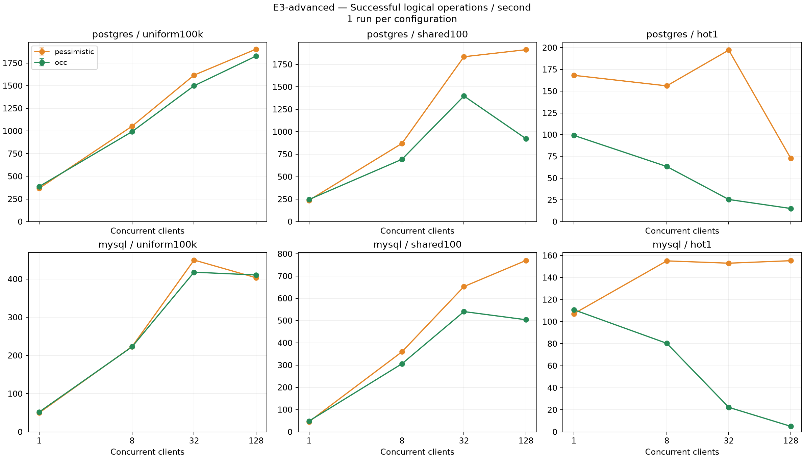
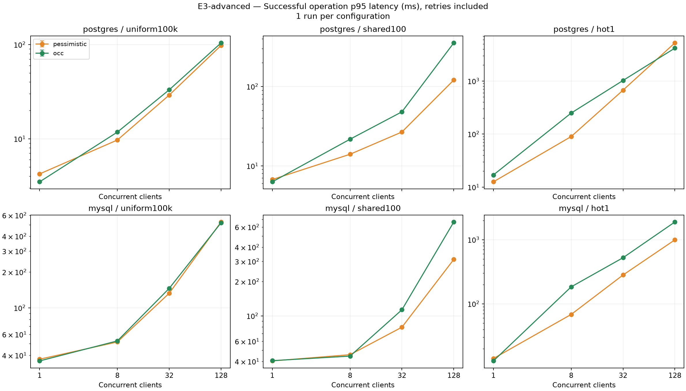
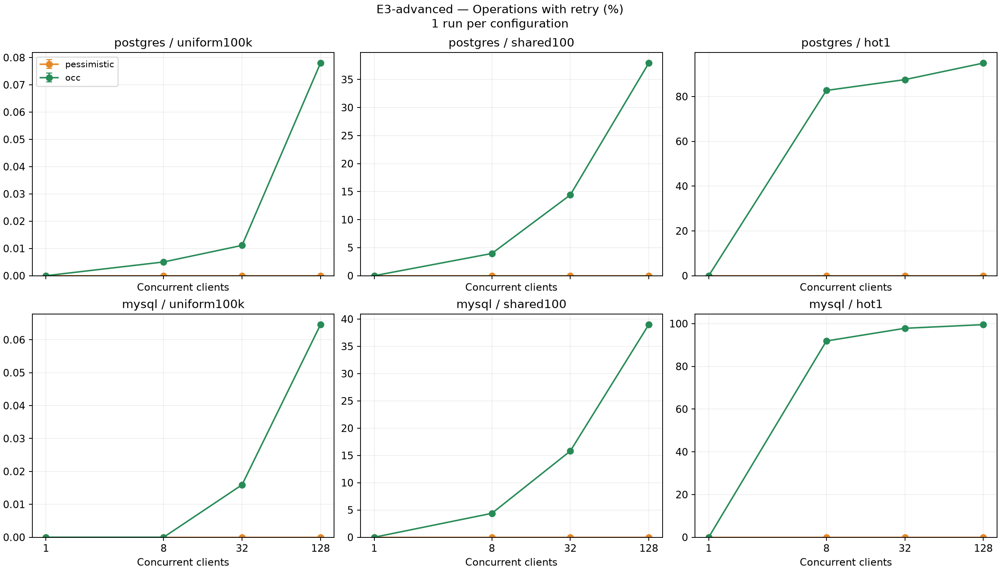
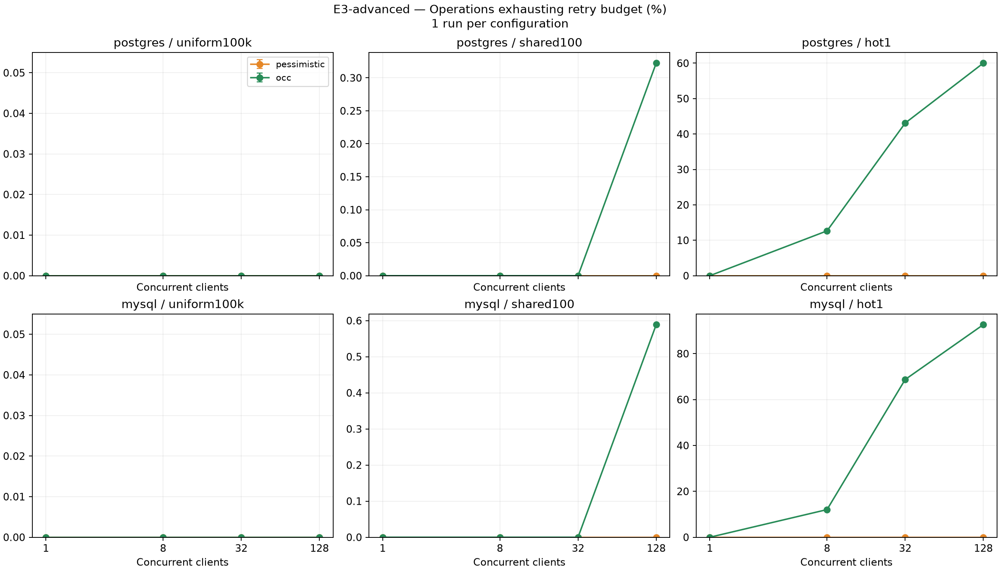

# E3-advanced — Báo cáo thực nghiệm OCC và khóa bi quan

**Đợt formal:** `formal-20261116T061602Z` · **Trạng thái:** PASS · **48/48 lượt** · **Mỗi cấu hình đo một lần**

## 1. Câu hỏi và thiết kế

So sánh cập nhật một bộ đếm `s_ytd` bằng khóa bi quan (`SELECT FOR UPDATE`, sau đó `UPDATE`) và OCC (đọc `version`, `UPDATE` có điều kiện rồi retry khi xung đột) trên PostgreSQL và MySQL. Đây là microbenchmark cập nhật một dòng, không phải toàn bộ giao dịch TPC-C.

Ma trận: 2 DBMS × 2 phương pháp × 3 phân bố dòng đích × 4 mức client (1, 8, 32, 128) × 1 lần đo = **48 lượt**. `uniform100k` chọn đều 100.000 dòng, `shared100` chọn đều 100 dòng, `hot1` chỉ chọn một dòng. Mỗi lượt warm-up 15 giây, nhận yêu cầu đo 60 giây rồi drain yêu cầu đã nhận. Hai DBMS chạy lần lượt, mỗi DBMS giới hạn 2 vCPU và 2 GiB RAM; generator Python trên Windows host không có quota tương ứng. Isolation là READ COMMITTED.

Mỗi lượt tạo bản sao đầy đủ 100.000 dòng `stock` và thêm cột version; không sửa bảng nguồn. Retry tối đa 8 lần thêm sau attempt đầu, chỉ cho version conflict hoặc deadlock xác định. TPS tính theo yêu cầu logic thành công chia cho thời gian nhận cộng drain; p95 chỉ xét yêu cầu thành công và bao gồm retry/backoff. Tỷ lệ retry và hết retry tính trên số yêu cầu logic.

## 2. Kiểm chứng và toàn cảnh

Cả **48/48 lượt PASS**. Kiểm tra offline đối chiếu CSV từng worker với số yêu cầu, số thành công, attempt, xung đột và p95; kiểm tra 100.000 bộ đếm mỗi lượt, cleanup bảng tạm, fingerprint dữ liệu nguồn hai hệ và hash bốn tệp E6. Kết quả: `source_unchanged=true` cho cả PostgreSQL/MySQL và `e6_unchanged=true`.

Toàn bộ ma trận ghi **1,503,122 yêu cầu đo**, **1,492,148 thành công**, **10,974 hết retry**, **225,851 xung đột version ở cấp attempt**, **0 deadlock** và **0 timeout**. Đây là tổng trên các cấu hình với tải và thông lượng khác nhau; không dùng tỷ lệ gộp này để xếp hạng hai phương pháp.

## 3. Kết quả theo từng cấu hình

TPS là yêu cầu thành công/giây; p95 là mili giây; hoàn tất, retry và hết retry là phần trăm yêu cầu logic. Mỗi ô là một lượt đo, không phải trung bình nhiều lần.

### POSTGRES

#### Phân bố đều 100.000 dòng (`uniform100k`)

| Client | Phương pháp | TPS | p95 (ms) | Hoàn tất (%) | Retry (%) | Hết retry (%) |
| --- | --- | --- | --- | --- | --- | --- |
| 1 | Khóa bi quan | 366.6 | 4.2 | 100.00 | 0.00 | 0.00 |
| 1 | OCC | 387.0 | 3.5 | 100.00 | 0.00 | 0.00 |
| 8 | Khóa bi quan | 1,052.6 | 9.7 | 100.00 | 0.00 | 0.00 |
| 8 | OCC | 992.7 | 11.8 | 100.00 | 0.01 | 0.00 |
| 32 | Khóa bi quan | 1,616.0 | 29.1 | 100.00 | 0.00 | 0.00 |
| 32 | OCC | 1,498.4 | 33.1 | 100.00 | 0.01 | 0.00 |
| 128 | Khóa bi quan | 1,902.8 | 98.1 | 100.00 | 0.00 | 0.00 |
| 128 | OCC | 1,826.2 | 104.4 | 100.00 | 0.08 | 0.00 |

#### Chia sẻ 100 dòng (`shared100`)

| Client | Phương pháp | TPS | p95 (ms) | Hoàn tất (%) | Retry (%) | Hết retry (%) |
| --- | --- | --- | --- | --- | --- | --- |
| 1 | Khóa bi quan | 237.2 | 6.7 | 100.00 | 0.00 | 0.00 |
| 1 | OCC | 246.1 | 6.3 | 100.00 | 0.00 | 0.00 |
| 8 | Khóa bi quan | 870.3 | 14.0 | 100.00 | 0.00 | 0.00 |
| 8 | OCC | 693.5 | 21.7 | 100.00 | 3.96 | 0.00 |
| 32 | Khóa bi quan | 1,834.8 | 26.7 | 100.00 | 0.00 | 0.00 |
| 32 | OCC | 1,397.9 | 48.0 | 100.00 | 14.41 | 0.00 |
| 128 | Khóa bi quan | 1,913.2 | 120.8 | 100.00 | 0.00 | 0.00 |
| 128 | OCC | 923.0 | 355.3 | 99.68 | 37.93 | 0.32 |

#### Một dòng nóng (`hot1`)

| Client | Phương pháp | TPS | p95 (ms) | Hoàn tất (%) | Retry (%) | Hết retry (%) |
| --- | --- | --- | --- | --- | --- | --- |
| 1 | Khóa bi quan | 168.2 | 12.6 | 100.00 | 0.00 | 0.00 |
| 1 | OCC | 99.2 | 16.9 | 100.00 | 0.00 | 0.00 |
| 8 | Khóa bi quan | 156.1 | 89.8 | 100.00 | 0.00 | 0.00 |
| 8 | OCC | 63.4 | 249.0 | 87.35 | 82.71 | 12.65 |
| 32 | Khóa bi quan | 197.2 | 673.4 | 100.00 | 0.00 | 0.00 |
| 32 | OCC | 25.5 | 1,025.7 | 56.91 | 87.54 | 43.09 |
| 128 | Khóa bi quan | 72.8 | 5,252.3 | 100.00 | 0.00 | 0.00 |
| 128 | OCC | 15.1 | 4,179.5 | 39.97 | 94.92 | 60.03 |

### MYSQL

#### Phân bố đều 100.000 dòng (`uniform100k`)

| Client | Phương pháp | TPS | p95 (ms) | Hoàn tất (%) | Retry (%) | Hết retry (%) |
| --- | --- | --- | --- | --- | --- | --- |
| 1 | Khóa bi quan | 49.8 | 37.0 | 100.00 | 0.00 | 0.00 |
| 1 | OCC | 51.8 | 35.8 | 100.00 | 0.00 | 0.00 |
| 8 | Khóa bi quan | 223.3 | 51.7 | 100.00 | 0.00 | 0.00 |
| 8 | OCC | 222.7 | 52.8 | 100.00 | 0.00 | 0.00 |
| 32 | Khóa bi quan | 449.7 | 132.8 | 100.00 | 0.00 | 0.00 |
| 32 | OCC | 417.9 | 146.0 | 100.00 | 0.02 | 0.00 |
| 128 | Khóa bi quan | 403.5 | 527.1 | 100.00 | 0.00 | 0.00 |
| 128 | OCC | 410.7 | 519.3 | 100.00 | 0.06 | 0.00 |

#### Chia sẻ 100 dòng (`shared100`)

| Client | Phương pháp | TPS | p95 (ms) | Hoàn tất (%) | Retry (%) | Hết retry (%) |
| --- | --- | --- | --- | --- | --- | --- |
| 1 | Khóa bi quan | 45.4 | 40.3 | 100.00 | 0.00 | 0.00 |
| 1 | OCC | 48.5 | 40.5 | 100.00 | 0.00 | 0.00 |
| 8 | Khóa bi quan | 359.6 | 45.7 | 100.00 | 0.00 | 0.00 |
| 8 | OCC | 305.9 | 44.4 | 100.00 | 4.38 | 0.00 |
| 32 | Khóa bi quan | 652.7 | 79.6 | 100.00 | 0.00 | 0.00 |
| 32 | OCC | 540.3 | 113.1 | 100.00 | 15.80 | 0.00 |
| 128 | Khóa bi quan | 769.9 | 312.4 | 100.00 | 0.00 | 0.00 |
| 128 | OCC | 503.7 | 664.8 | 99.41 | 38.98 | 0.59 |

#### Một dòng nóng (`hot1`)

| Client | Phương pháp | TPS | p95 (ms) | Hoàn tất (%) | Retry (%) | Hết retry (%) |
| --- | --- | --- | --- | --- | --- | --- |
| 1 | Khóa bi quan | 107.1 | 14.0 | 100.00 | 0.00 | 0.00 |
| 1 | OCC | 110.8 | 12.9 | 100.00 | 0.00 | 0.00 |
| 8 | Khóa bi quan | 155.1 | 68.3 | 100.00 | 0.00 | 0.00 |
| 8 | OCC | 80.3 | 183.9 | 87.95 | 91.87 | 12.05 |
| 32 | Khóa bi quan | 153.0 | 281.5 | 100.00 | 0.00 | 0.00 |
| 32 | OCC | 22.3 | 523.4 | 31.26 | 97.81 | 68.74 |
| 128 | Khóa bi quan | 155.3 | 994.2 | 100.00 | 0.00 | 0.00 |
| 128 | OCC | 5.0 | 1,888.6 | 7.35 | 99.52 | 92.65 |

## 4. Đối chiếu và diễn giải

Ở `uniform100k`, tỷ lệ retry OCC dưới 0,1% tại mọi mức client của cả hai DBMS; TPS OCC và khóa bi quan gần nhau hơn so với hai phân bố còn lại. Khi chỉ còn 100 dòng chia sẻ, xung đột OCC tăng theo số client: tại 128 client, retry là 37,93% trên PostgreSQL và 38,98% trên MySQL. TPS OCC ở điểm này lần lượt bằng khoảng 48% và 65% TPS khóa bi quan.

Với `hot1`, tất cả client tranh cùng một dòng. Ở 128 client, kết quả cụ thể:

| DBMS | TPS khóa | TPS OCC | OCC hoàn tất (%) | OCC retry (%) | OCC hết retry (%) | p95 khóa (ms) | p95 OCC (ms) |
| --- | --- | --- | --- | --- | --- | --- | --- |
| postgres | 72.8 | 15.1 | 39.97 | 94.92 | 60.03 | 5,252.3 | 4,179.5 |
| mysql | 155.3 | 5.0 | 7.35 | 99.52 | 92.65 | 994.2 | 1,888.6 |

Tại điểm này, OCC mất nhiều yêu cầu vì hết ngân sách retry; p95 chỉ trên yêu cầu thành công nên phải đọc cùng tỷ lệ hoàn tất. Khóa bi quan giữ tỷ lệ hoàn tất cao hơn nhưng cũng có độ trễ lớn khi nhiều client chờ cùng dòng. So sánh giữa PostgreSQL và MySQL trong bảng là kết quả end-to-end của cả driver, giao tiếp Windows–Docker và generator, không cô lập riêng hiệu năng engine.

## 5. Biểu đồ

### Thông lượng thành công

### p95 của yêu cầu thành công

### Tỷ lệ yêu cầu có retry

### Tỷ lệ yêu cầu hết retry

## 6. Giới hạn và khả năng tái lập

**Mỗi cấu hình chỉ đo một lần.** Không có ước lượng phương sai, khoảng tin cậy hoặc kiểm định ý nghĩa thống kê; các chênh lệch nhỏ có thể do biến động theo thời gian, nhiệt độ, cache hoặc tải nền. Thứ tự chạy cố định theo lịch lưu trong run. Các phân bố còn thay đổi working set và locality; benchmark không có thao tác nhiều dòng, đọc thuần hay think time. Không suy rộng thứ hạng sang mọi ứng dụng.

Bảng dữ liệu nguồn được kiểm tra không đổi, nhưng DBMS/driver và host vẫn là thành phần của phép đo. Raw CSV, metadata môi trường, tài nguyên, bản mã nguồn và cleanup từng lượt được giữ cùng run để kiểm tra lại.

## 7. Nguồn dữ liệu

- [Giao thức](experiments/e3_advanced_protocol.json) và [hướng dẫn](experiments/E3_ADVANCED_README.md)
- [Formal report](experiments/e3_advanced_logs/formal-20261116T061602Z/report.json), [lịch chạy](experiments/e3_advanced_logs/formal-20261116T061602Z/schedule.json), [48 dòng tổng hợp](experiments/e3_advanced_logs/formal-20261116T061602Z/analysis/summary.csv), [48 dòng trial](experiments/e3_advanced_logs/formal-20261116T061602Z/analysis/trials.csv)
- [Biên bản kiểm chứng và SHA-256 raw CSV](experiments/e3_advanced_logs/formal-20261116T061602Z/analysis/validation.json)
