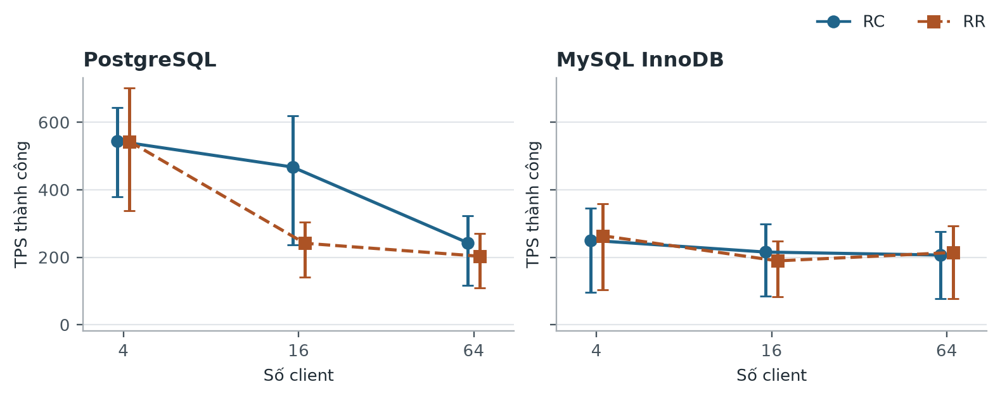
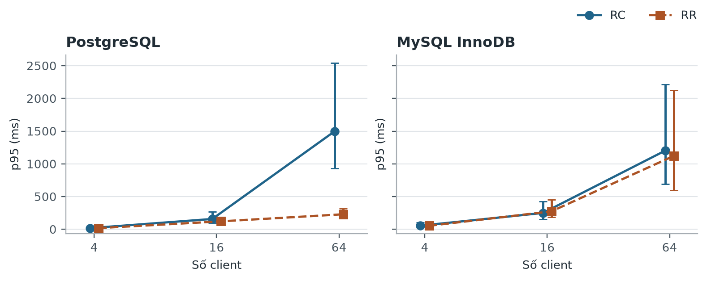
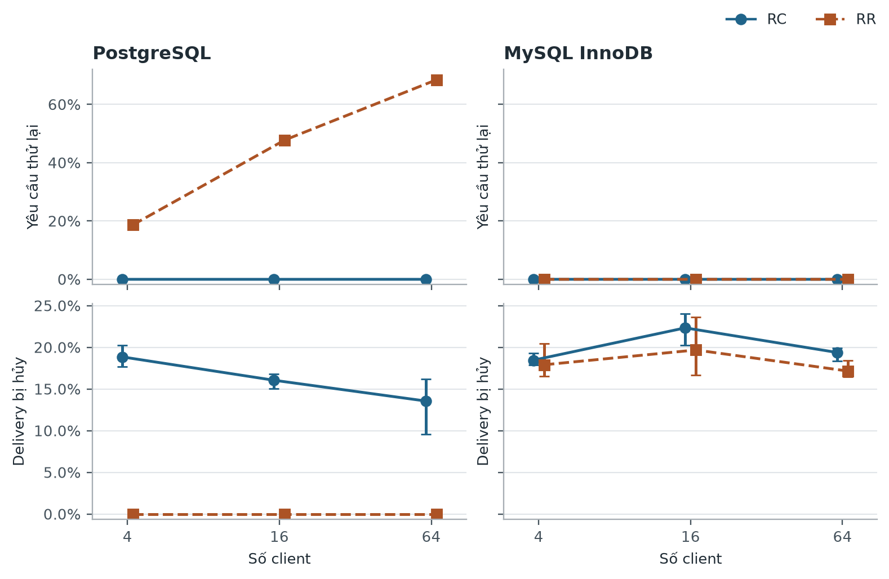
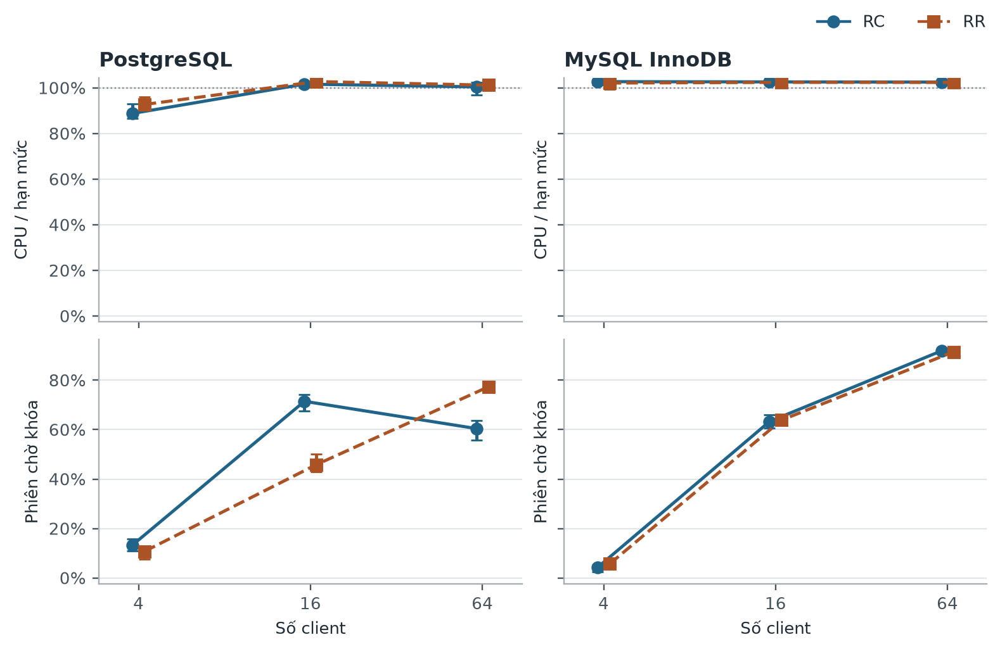

# 3. Thực nghiệm và so sánh với hệ quản trị cơ sở dữ liệu truyền thống

Chương này đánh giá khả năng xử lý giao dịch đồng thời và tranh chấp dữ liệu qua hai lớp thực nghiệm. Lớp thứ nhất sử dụng các lịch giao dịch được điều phối trên một số ít bản ghi để quan sát tính đúng đắn của cơ chế đọc đa phiên bản (MVCC), khóa và kiểm soát đồng thời lạc quan ở tầng ứng dụng (OCC). Lớp thứ hai sử dụng workload hỗn hợp trên BenchBase để đo thông lượng, độ trễ và các biểu hiện tranh chấp khi tăng số client đồng thời. PostgreSQL là hệ quản trị được khảo sát chính; MySQL với storage engine InnoDB được sử dụng làm hệ đối chứng.

Các kết quả được tổng hợp từ tài liệu, cấu hình và log đã lưu trong kho mã nguồn, trong đó benchmark E6 gồm 36 lượt RC/RR chạy ngày 25/11/2026. Các thực nghiệm kiểm chứng cơ chế được ký hiệu E1–E4; benchmark hỗn hợp được ký hiệu E6 theo hệ thống đặt tên của dự án. E5 không nằm trong phạm vi kết quả được báo cáo.

**Phạm vi của phép so sánh:** MVCC, khóa và OCC không phải ba chế độ độc lập được bật hoặc tắt trong benchmark hiện có. MVCC và khóa cùng tham gia xử lý giao dịch của DBMS; OCC trong E3 là cơ chế kiểm tra cột phiên bản do ứng dụng bổ sung. Vì vậy, chương này đối chiếu hành vi của ba cơ chế qua các kịch bản nhỏ, sau đó đánh giá hiệu năng của toàn hệ thống bằng E6. Dữ liệu hiện có chưa cho phép xếp hạng thông lượng của ba cơ chế trên cùng một workload chuẩn hóa.

## 3.1. Thực nghiệm trên PostgreSQL

### 3.1.1. Môi trường và thiết lập chạy thực nghiệm

Thực nghiệm được triển khai trên máy Windows 11, sử dụng Docker trên WSL2 để vận hành cơ sở dữ liệu và bộ sinh tải. Môi trường benchmark được ghi nhận trước và sau khi chạy; image được ghim theo digest nhằm hạn chế thay đổi phiên bản giữa các lượt. Bảng 3.1 trình bày cấu hình chính của đợt benchmark chính thức. Các demo E1–E4 được thực hiện riêng và không được xem là đã có cùng toàn bộ điều kiện kiểm soát tài nguyên của E6.

**Bảng 3.1. Môi trường benchmark chính thức.**

| Thành phần | Cấu hình |
|---|---|
| Máy chủ vật lý | Intel Core i7-1355U, 12 luồng logic; RAM khoảng 15,7 GiB |
| Nền tảng | Windows 11; Docker WSL2 có khoảng 7,6 GiB RAM |
| Hệ quản trị chính | PostgreSQL 17.12 |
| Hệ quản trị đối chứng | MySQL 8.4.13, InnoDB |
| Hạn mức mỗi DBMS | 2 vCPU, 2 GiB RAM, không cấp thêm swap |
| Bộ sinh tải | 4 vCPU, 1 GiB RAM; Java heap tối đa 512 MiB |
| BenchBase | Commit `33c00473807ebd49304d114a6d769d2d2b2bbb34`, có bổ sung instrumentation |
| Isolation của kết nối workload | READ COMMITTED và REPEATABLE READ trong từng DBMS |
| Cache cấu hình được ghi nhận | PostgreSQL `shared_buffers = 128 MiB`; MySQL `innodb_buffer_pool_size = 128 MiB` |
| Giới hạn kết nối | `max_connections = 200` |
| Durability PostgreSQL | Bật `fsync`, `synchronous_commit`, `full_page_writes` |
| Durability MySQL | `innodb_flush_log_at_trx_commit = 1`. Binary log tắt trong cả 18 lượt MySQL. |

Nguồn: [môi trường E6](benchbase/benchmark/isolation/formal-20261125T052730347909Z/environment.json) và [hướng dẫn benchmark](benchbase/benchmark/README.md).

Dữ liệu sử dụng mô hình TPC-C-like với một warehouse và chín bảng. Quy mô ban đầu của mỗi DBMS là 599.051 bản ghi, được kiểm tra trong [biên bản xác minh dataset](benchbase/logs/dataset-verification.json).

**Bảng 3.2. Quy mô dữ liệu ban đầu trên mỗi DBMS.**

| Bảng | Số bản ghi | Vai trò trong mô hình |
|---|---:|---|
| `warehouse` | 1 | Kho hàng |
| `district` | 10 | Đơn vị trực thuộc kho |
| `customer` | 30.000 | Khách hàng |
| `history` | 30.000 | Lịch sử thanh toán |
| `item` | 100.000 | Danh mục mặt hàng |
| `stock` | 100.000 | Tồn kho theo mặt hàng |
| `oorder` | 30.000 | Đơn hàng |
| `new_order` | 9.000 | Đơn hàng chờ xử lý |
| `order_line` | 300.040 | Chi tiết đơn hàng |
| **Tổng cộng** | **599.051** | |

Cơ sở dữ liệu `tpcc` được giữ làm nguồn và phục vụ demo. Benchmark ghi vào cơ sở dữ liệu riêng `tpcc_bench`, được phục hồi từ baseline trước từng lượt. Hai baseline có cùng cấu trúc logic và quy mô; không giả định mọi giá trị ngẫu nhiên hoặc timestamp giống nhau tuyệt đối. Sau phục hồi, hệ thống kiểm tra số dòng, các tổng số học và cập nhật thống kê bằng `ANALYZE`.

Cách tổ chức này tách dữ liệu nguồn khỏi quá trình sinh tải, đồng thời giảm ảnh hưởng của lượng dữ liệu tích lũy từ lượt trước lên lượt sau. Tuy nhiên, đây không phải thử nghiệm cold cache: cache hệ điều hành không bị ép xóa, và warm-up tiếp tục làm thay đổi dữ liệu trước cửa sổ đo.

### 3.1.2. Đánh giá tính đúng đắn của cơ chế với dữ liệu nhỏ

Nhóm thử nghiệm này kiểm tra trạng thái dữ liệu và quan hệ giữa các giao dịch trên một dòng warehouse hoặc một đến hai dòng stock. E1 và E2a chạy READ COMMITTED (RC) và REPEATABLE READ (RR) trên cả PostgreSQL và MySQL InnoDB; E4 sử dụng RC trên cả hai hệ. Các kết nối độc lập được điều phối để kiểm tra giá trị đọc, trạng thái trước và sau COMMIT/ROLLBACK, số giao dịch bị hủy (abort), số lần thử lại (retry) và khôi phục dữ liệu. E1 đối chiếu cơ chế snapshot ở mục 2.2.3; E2a đối chiếu xung đột ghi ở mục 2.2.4; E4 đối chiếu lý thuyết khóa/deadlock ở mục 2.1.3.

#### 3.1.2.1. Kịch bản kiểm thử với dữ liệu nhỏ

**Bảng 3.3. Các kịch bản kiểm chứng cơ chế.**

| Mã | Mục tiêu | Lịch giao dịch chính | Tiêu chí quan sát |
|---|---|---|---|
| E1 | Kiểm chứng đọc đa phiên bản | T1 UPDATE warehouse và giữ chưa commit; T2 SELECT trước và sau khi T1 commit | Cả hai DBMS chạy RC/RR. Lần đầu đọc B; lần hai RC đọc B \+ 100, RR đọc B; giao dịch mới thấy B \+ 100\. |
| E2a | Đối chiếu xung đột ghi ở RC/RR trên cả hai DBMS | Hai UPDATE tăng cùng bộ đếm; xác nhận T2 chờ ít nhất 100 ms trước COMMIT của T1 | RC trên hai hệ và MySQL RR: 0 abort/retry, cuối B + 2; PostgreSQL RR: 1 abort 40001, sau rollback B + 1, sau 1 retry B + 2 |
| E2b | Khảo sát sơ bộ contention ở RC | distinct/shared4/hot1 với 1/4/8/16 client theo thiết kế cũ | Chỉ mô tả mẫu chờ khóa; không xem là benchmark chính thức |
| E3 | Tái hiện lost update và đánh giá OCC | Hai transaction cùng đọc counter; lần lượt thử ghi thường, ghi có version và ghi có version kèm retry | Phân biệt cập nhật bị mất, xung đột được phát hiện và yêu cầu hoàn tất sau retry |
| E4 | Kiểm chứng deadlock và thứ tự lấy khóa | Hai transaction cập nhật hai dòng A/B theo thứ tự ngược nhau hoặc cùng thứ tự | Phân biệt deadlock với chờ thông thường; kiểm tra rollback, retry và giá trị cuối |

Trong [**E1**](https://github.com/ncmanh-uet/dbms-project-report/blob/3cb827cd950aefc09a3c779bd7afa315877b875e/experiments/e1_mvcc.py), hai giao dịch T1 và T2 thao tác trên warehouse.w\_ytd với w\_id \= 1\. T1 khóa dòng bằng SELECT … FOR UPDATE, tăng giá trị từ 300.000 lên 300.100 và chưa COMMIT. T2 thực hiện SELECT thông thường; sau khi lần đọc này hoàn tất, T1 mới COMMIT. T2 sau đó đọc lại trong cùng giao dịch. Cùng lịch được chạy ở RC và RR trên cả hai DBMS; các kết nối T1/T2 trong mỗi trường hợp dùng cùng mức cô lập.

Lần đọc đầu của T2 phải trả về 300.000. Sau COMMIT của T1, lần đọc thứ hai phải trả về 300.100 ở RC và 300.000 ở RR trên cả hai DBMS. Khi T2 kết thúc, một giao dịch mới kiểm tra giá trị đã lưu là 300.100; dữ liệu sau đó được khôi phục về 300.000. Dữ liệu, lịch giao dịch và cấu hình được giữ cố định khi thay mức cô lập trên từng DBMS.

Trong [**E2a**](https://github.com/ncmanh-uet/dbms-project-report/blob/3cb827cd950aefc09a3c779bd7afa315877b875e/experiments/e2_contention.py), T1 và T2 cùng thực hiện UPDATE stock SET s\_ytd \= s\_ytd \+ 1 trên bản ghi có s\_w\_id \= 1 và s\_i\_id \= 1, với giá trị ban đầu B \= 0\. T1 cập nhật trước và chưa COMMIT; T2 thực hiện cùng câu lệnh nên phải chờ. Một kết nối quan sát xác nhận T2 bị T1 chặn qua hai mẫu trạng thái khóa cách nhau ít nhất 100 ms, sau đó mới cho T1 COMMIT. Kịch bản chạy RC và RR trên cả hai DBMS.

Ở RC trên cả hai DBMS và RR trên MySQL, T2 tiếp tục cập nhật sau COMMIT của T1; bộ đếm đạt B \+ 2, với 0 abort và 0 retry. Ở PostgreSQL RR, T2 nhận SQLSTATE 40001 và ROLLBACK; bộ đếm lúc này bằng B \+ 1\. Thử lại toàn bộ T2 trong giao dịch RR mới đưa bộ đếm lên B \+ 2, tương ứng 1 abort và 1 retry. Sau kiểm tra, dữ liệu được khôi phục về B. Thời gian UPDATE gồm khoảng giữ khóa có chủ đích, nên không dùng để so sánh tốc độ hai DBMS.

Trong **E3**, chương trình sao chép 16 dòng stock vào bảng hỗ trợ có tên riêng cho lượt chạy, bổ sung `counter_value` và `version`. Bảng này được chia sẻ giữa các connection và không làm thay đổi cấu trúc bảng stock nguồn. Mỗi pha demo được đặt lại về counter ban đầu 0 và version 1:

1. **Ghi không kiểm tra version:** T1 và T2 cùng đọc 0, cùng tính 1; T1 ghi và commit, sau đó T2 ghi lại 1 và commit.
2. **Phát hiện xung đột bằng version:** cả hai đọc version 1; T1 cập nhật và tăng version lên 2; T2 UPDATE với version cũ nên không khớp dòng nào và rollback.
3. **OCC kết hợp retry:** sau xung đột, T2 mở transaction mới, đọc lại counter/version, tính lại và thực hiện UPDATE có điều kiện.

Câu lệnh dưới đây minh họa điều kiện ghi của OCC; tên bảng thực tế được gắn mã lượt chạy:

```sql
UPDATE bang_ho_tro_occ
SET counter_value = :gia_tri_tinh_lai,
    version = version + 1
WHERE s_w_id = 1
  AND s_i_id = :item
  AND version = :version_da_doc;
```

Trong [**E4**](https://github.com/ncmanh-uet/dbms-project-report/blob/b757f71bd1ea3a542700f9807e5f3a5b34917589/experiments/e4_deadlock.py), hai giao dịch ở READ COMMITTED cùng tăng s\_ytd trên hai bản ghi stock thuộc warehouse 1: item 1 (A) và item 2 (B). Với lịch opposite, T1 cập nhật A rồi B, còn T2 cập nhật B rồi A. Hai giao dịch được đồng bộ để cùng giữ khóa đầu tiên trước khi yêu cầu bản ghi còn lại. Hệ thống phải phát hiện deadlock và hủy một giao dịch, trong khi giao dịch còn lại COMMIT. Sau ROLLBACK, mỗi bản ghi phải tăng đúng một đơn vị. Thử lại toàn bộ giao dịch bị hủy trong một giao dịch mới phải đưa mức tăng của mỗi bản ghi lên hai đơn vị.

Với lịch ordered, cả hai giao dịch đều cập nhật A rồi B. Tiêu chí đạt là hai giao dịch commit thành công, không deadlock, không retry và mỗi bản ghi tăng hai đơn vị. Mỗi lịch được chạy năm lượt trên mỗi DBMS; dữ liệu được kiểm tra và khôi phục sau từng lượt. Deadlock được xác định bằng mã lỗi của DBMS và được phân biệt với lỗi hết thời gian chờ khóa.

#### 3.1.2.2. Kết quả phân tích trạng thái và tính nhất quán trên ba cơ chế

**Bảng 3.4. Đối chiếu E1, E2a, E4 trên PostgreSQL/MySQL và kết quả E3 trên PostgreSQL.**

| Kịch bản / isolation | PostgreSQL | MySQL InnoDB |
| ----- | ----- | ----- |
| E1 — RC | T2: 300.000 → 300.100; 0 abort, 0 retry. | T2: 300.000 → 300.100; 0 abort, 0 retry. |
| E1 — RR | T2: 300.000 → 300.000; 0 abort, 0 retry. | T2: 300.000 → 300.000; 0 abort, 0 retry. |
| E2a — RC | Bộ đếm 0 → 2; 0 abort, 0 retry. | Bộ đếm 0 → 2; 0 abort, 0 retry. |
| E2a — RR | 1 abort 40001; sau ROLLBACK: 1; sau 1 retry: 2\. | Bộ đếm 0 → 2 sau hai COMMIT; 0 abort, 0 retry. |
| E4 — ngược thứ tự, RC | 5/5 cặp: 1 abort 40P01 và 1 retry/cặp. A/B: 0 → 1 sau rollback → 2 sau retry. | 5/5 cặp: 1 abort 1213/40001 và 1 retry/cặp. A/B: 0 → 1 sau rollback → 2 sau retry. |
| E4 — cùng thứ tự, RC | 5/5 cặp: A/B từ 0 lên 2; 0 abort, 0 retry. | 5/5 cặp: A/B từ 0 lên 2; 0 abort, 0 retry. |
| E3 — ghi thường | Hai COMMIT nhưng counter cuối bằng 1; Tái hiện lost update của chuỗi đọc–tính–ghi ở ứng dụng | — |
| E3 — kiểm tra version | Counter \= 1, version \= 2; phát hiện một conflict; Lần ghi dựa trên dữ liệu cũ bị từ chối | — |
| E3 — version và retry | Counter \= 2, version \= 3; Hai yêu cầu logic hoàn tất sau khi đọc lại và tính lại | — |

Nguồn kết quả: [E1](https://github.com/ncmanh-uet/dbms-project-report/blob/3cb827cd950aefc09a3c779bd7afa315877b875e/experiments/e1_logs/20261125T030706_536131Z/summary.json) ([lịch thực thi](https://github.com/ncmanh-uet/dbms-project-report/blob/3cb827cd950aefc09a3c779bd7afa315877b875e/experiments/e1_logs/20261125T030706_536131Z/timeline.log)); [E2a](https://github.com/ncmanh-uet/dbms-project-report/blob/3cb827cd950aefc09a3c779bd7afa315877b875e/experiments/e2_logs/20261125T030708_295092Z/summary.json) ([lịch thực thi](https://github.com/ncmanh-uet/dbms-project-report/blob/3cb827cd950aefc09a3c779bd7afa315877b875e/experiments/e2_logs/20261125T030708_295092Z/timeline.log)); [E4](https://github.com/ncmanh-uet/dbms-project-report/blob/3cb827cd950aefc09a3c779bd7afa315877b875e/experiments/e4_logs/20261123T075540_787330Z/summary.json) ([lịch thực thi](https://github.com/ncmanh-uet/dbms-project-report/blob/3cb827cd950aefc09a3c779bd7afa315877b875e/experiments/e4_logs/20261123T075540_787330Z/timeline.log)); [kiểm chứng dữ liệu](https://github.com/ncmanh-uet/dbms-project-report/blob/3cb827cd950aefc09a3c779bd7afa315877b875e/experiments/e124_verification/20261125/verification.json). Dữ liệu E1 được khôi phục về 300.000; E2a/E4 về 0\. Trong E1, giao dịch mới sau T2 đều đọc 300.100. Mã MySQL deadlock được ghi theo errno/SQLSTATE.

Kết quả E1 phù hợp với cơ chế snapshot ở mục 2.2.3: RC lấy snapshot theo từng câu SELECT, còn RR giữ snapshot đọc trong cùng giao dịch trên cả hai DBMS. T2 ở RR vẫn đọc 300.000 sau COMMIT của T1, trong khi giao dịch mới đọc được 300.100. Cả bốn trường hợp có 0 abort, 0 retry và khôi phục dữ liệu thành công.

E2a làm rõ khác biệt giữa hai hệ ở cùng mức RR. PostgreSQL hủy T2 khi dòng đích đã thay đổi sau snapshot; thử lại toàn bộ giao dịch với snapshot mới đưa bộ đếm từ 1 lên 2\. MySQL InnoDB thực hiện UPDATE theo trạng thái hiện hành (current read), nên T2 chờ rồi cập nhật nối tiếp và đạt 2 ngay sau hai COMMIT, không cần retry trong lịch này. Khác biệt này không có nghĩa MySQL RR không thể phát sinh lỗi 40001: E4 ghi nhận SQLSTATE này khi deadlock. Ngược lại, E3 cho thấy khóa của từng UPDATE không tự khắc phục việc ứng dụng sử dụng giá trị đã đọc cũ: nếu cả hai bên cùng tính 1 rồi ghi lại 1, hai COMMIT vẫn có thể chỉ tạo một lần tăng thực tế.

OCC giải quyết trường hợp E3 bằng cách kiểm tra xem phiên bản đã đọc còn hợp lệ tại thời điểm ghi hay không. Khi không khớp version, ứng dụng phải rollback và quyết định retry hoặc trả thất bại. Retry đúng phải đọc lại và tính lại trong transaction mới; gửi lại nguyên giá trị/version cũ không giải quyết được xung đột. UPDATE có điều kiện vẫn sử dụng cơ chế MVCC và khóa bên dưới của DBMS.

**Bảng 3.5. Đối chiếu vai trò và giới hạn của ba cơ chế từ thử nghiệm nhỏ.**

| Khía cạnh | MVCC | Khóa | OCC ở tầng ứng dụng |
|---|---|---|---|
| Vai trò được kiểm chứng | Cung cấp phiên bản phù hợp cho câu đọc | Điều phối các thao tác ghi xung đột | Phát hiện kết quả tính dựa trên phiên bản cũ |
| Bằng chứng chính | E1 | E2 và E4 | E3 |
| Biểu hiện khi có cạnh tranh | Plain SELECT vẫn đọc bản đã commit trong E1 | Chờ khóa; có thể deadlock khi có vòng chờ | UPDATE không khớp version; rollback và retry |
| Điều kiện để yêu cầu hoàn tất đúng | Phụ thuộc isolation và logic nghiệp vụ | Cần xử lý transaction bị hủy, quản lý thứ tự truy cập | Kiểm tra số dòng cập nhật, đọc lại/tính lại khi retry |
| Giới hạn quan sát | Không tự bảo vệ mọi chuỗi đọc–tính–ghi | Giữ khóa làm tăng chờ; không sửa giá trị tính sẵn đã cũ | Có chi phí thử lại; có thể hết ngân sách retry |

[**E2b**](https://github.com/ncmanh-uet/dbms-project-report/blob/b757f71bd1ea3a542700f9807e5f3a5b34917589/experiments/e2_logs/20261109T152250_363110Z/trials.csv) khảo sát chờ khóa ở RC với 1, 4, 8 và 16 client trên ba phân bố: mỗi client cập nhật một dòng riêng (distinct), cùng truy cập bốn dòng (shared4), hoặc cùng cập nhật một dòng (hot1). Mỗi cấu hình chạy một lượt 10 giây, không warm-up.

E2b đã đối chiếu đủ 24 lượt với CSV giao dịch và COMMIT theo từng dòng: tất cả bộ đếm cuối bằng giá trị ban đầu cộng số COMMIT, 0 failed attempt, 0 abort, 0 retry; khôi phục dữ liệu đều đạt. Số liệu 16 client được tổng hợp dưới đây; tổng bộ đếm là tổng s\_ytd trên các dòng đích trước khôi phục, có giá trị ban đầu bằng 0\.

| DBMS | Phân bố | COMMIT \= tổng bộ đếm cuối | Chờ cực đại |
| ----- | ----- | ----- | ----- |
| PostgreSQL | distinct | 14328 \= 14328 | 0 |
| PostgreSQL | shared4 | 7117 \= 7117 | 12 |
| PostgreSQL | hot1 | 2383 \= 2383 | 15 |
| MySQL | distinct | 4348 \= 4348 | 0 |
| MySQL | shared4 | 2904 \= 2904 | 12 |
| MySQL | hot1 | 812 \= 812 | 15 |

Nguồn: [kiểm chứng 24 lượt E2b](https://github.com/ncmanh-uet/dbms-project-report/blob/3cb827cd950aefc09a3c779bd7afa315877b875e/experiments/e124_verification/20261125/e2b-summary.json); [số liệu gốc](https://github.com/ncmanh-uet/dbms-project-report/blob/3cb827cd950aefc09a3c779bd7afa315877b875e/experiments/e2_logs/20261109T152250_363110Z/trials.csv). Sau mỗi lượt, từng dòng được khôi phục về 0\. Failed attempt là lần thực thi không thành công, không mặc nhiên đồng nghĩa với abort do xung đột. Số chờ là cực đại trong các mẫu, không phải tổng sự kiện chờ. Mỗi cấu hình chỉ chạy một lượt 10 giây, không warm-up.

Trong E3, tổng các cấu hình nhiều client truy cập hot row trên hai DBMS có 423 yêu cầu logic hết ngân sách retry, dù mỗi yêu cầu được phép tối đa tám lần thử lại sau lần đầu. Counter và version vẫn khớp số yêu cầu thực sự thành công. Do đó, dữ liệu cuối nhất quán theo các yêu cầu đã chấp nhận không đồng nghĩa mọi yêu cầu đầu vào đều hoàn tất. Các lượt sơ bộ chỉ chạy một lần mỗi cấu hình, không warm-up; chúng được dùng để minh họa cơ chế, không dùng làm phép so sánh TPS chính thức.

Các kiểm tra khôi phục dữ liệu E1/E2/E4 và dọn bảng hỗ trợ E3 đều đạt trong các lượt được trích dẫn. Riêng nhãn PASS của pha lost update có nghĩa là tái hiện đúng lỗi mong đợi, không có nghĩa trạng thái nghiệp vụ cuối là đúng. Tương tự, kết quả không deadlock của lịch `ordered` chỉ chứng minh cho mô hình hai dòng đã thử, không bảo đảm mọi workload phức tạp đều hết deadlock.

### 3.1.3. Đánh giá hiệu năng với workload lớn thông qua thực nghiệm E6

#### 3.1.3.1. Tải giao dịch và biến kiểm thử BenchBase

E6 sử dụng BenchBase để sinh đồng thời năm loại giao dịch nghiệp vụ trên dataset TPC-C-like. Trong phần này, “workload lớn” được hiểu là số lượng yêu cầu và mức đồng thời lớn hơn các demo có điều phối; dataset vẫn chỉ có một warehouse và chưa đại diện cho cơ sở dữ liệu quy mô sản xuất. Cơ chế mà E6 sử dụng để xử lý đồng thời là MVCC và Locking (tương ứng với các thực nghiệm nhỏ là E1, E2, E4, không chứa E3 vì E3 là cơ chế ở tầng ứng dụng, không phải tầng DB).

**Bảng 3.6. Thành phần workload hỗn hợp.**

| Loại giao dịch | Trọng số cấu hình | Nội dung nghiệp vụ chính |
| --- | --- | --- |
| NewOrder | 45% | Tạo đơn hàng và cập nhật tồn kho |
| Payment | 43% | Ghi nhận thanh toán, cập nhật số liệu kho, district và khách hàng |
| OrderStatus | 4% | Tra cứu trạng thái đơn hàng |
| Delivery | 4% | Xử lý các đơn hàng chờ giao |
| StockLevel | 4% | Kiểm tra mức tồn kho |

Đây là trọng số sinh yêu cầu, không phải tỷ lệ SUCCESS bắt buộc quan sát được. Với một warehouse, nhiều Payment có thể cập nhật cùng dòng tổng tiền thanh toán warehouse.w_ytd; NewOrder còn chia sẻ district và stock. Thiết kế này tạo điều kiện quan sát contention tập trung, nhưng không có nghĩa mọi request đều ghi vào một dòng duy nhất.

**Bảng 3.7. Biến số và điều kiện kiểm soát của E6.**

| Nhóm | Thiết lập |
| --- | --- |
| Biến khảo sát chính | Mức cô lập RC/RR và số client đồng thời: 4, 16, 64. |
| Biến đối chứng | PostgreSQL và MySQL InnoDB |
| Điều kiện dữ liệu | Một warehouse; restore baseline riêng của engine trước từng lượt |
| Isolation và tải | Tải khép kín, rate = unlimited, không thêm think time. |
| Thời gian | Warm-up 15 giây, sau đó đo cấu hình 60 giây |
| Số lần lặp | Ba lượt cho mỗi cấu hình DBMS × số client × mức cô lập. |
| Ngân sách retry | Tối đa ba attempt tổng cộng cho mỗi request, gồm lần đầu |
| Thu thập bổ sung | Metadata session/lock khoảng 1 giây/lần; Docker CPU/RAM khoảng 2 giây/lần |

Trong mô hình client khép kín, số client là mức đồng thời được cấu hình; đây không phải phép đo khả năng đáp ứng một luồng yêu cầu ngoài hệ thống có tốc độ đến cố định. Mỗi client tiếp tục phát yêu cầu sau khi xử lý yêu cầu trước, nên độ trễ và tốc độ phát tải có liên hệ với nhau.

Hai chỉ tiêu hiệu năng chính được định nghĩa như sau:

Successful TPS: số request có trạng thái cuối SUCCESS, bắt đầu và kết thúc trong cửa sổ đo hợp lệ, chia cho thời gian đo thực tế do BenchBase ghi nhận. Chỉ tiêu này tính toàn bộ hỗn hợp giao dịch, không phải tpmC được chứng nhận.

p95 của request thành công: phân vị 95% độ trễ của các request SUCCESS trong từng lượt, bao gồm các attempt và retry bên trong request. Khi tổng hợp ba lượt, báo cáo sử dụng trung bình của ba giá trị p95, không phải p95 tính trên tập request gộp.

Với lượt chạy thứ i, công thức thông lượng là:

TPSᵢ = N(SUCCESS, i) / T(MEASURE, i);    TPS trung bình = (TPS₁ + TPS₂ + TPS₃) / 3.

Thời gian đo thực tế có thể dài hơn 60 giây cấu hình khoảng một giây; phép tính sử dụng giá trị thực tế. Khoảng min–max trong các bảng và hình biểu diễn độ phân tán của ba lượt, không phải khoảng tin cậy thống kê.

Bản BenchBase sử dụng có bộ đếm SUCCESS gốc bao gồm warm-up. Vì vậy, dự án bổ sung CSV theo request tại đúng điều kiện ghi latency để tính successful TPS trong cửa sổ đo, thay vì sử dụng trực tiếp goodput gốc. Số request được đối chiếu với Measured Requests của BenchBase. Việc ghi metrics có thể tạo overhead và được áp dụng cho cả hai DBMS.

#### 3.1.3.2. Quy trình đo RC và RR trên PostgreSQL

Trên PostgreSQL 17.12, nhóm chạy 18 lượt E6 gồm hai mức cô lập READ COMMITTED (RC) và REPEATABLE READ (RR), ba mức 4, 16 và 64 client, mỗi cấu hình lặp ba lần. Mỗi cặp RC/RR dùng cùng số client và cùng lần lặp. Thứ tự RC/RR đảo theo mức client và lần lặp.

1. Phục hồi tpcc_bench từ baseline PostgreSQL, kiểm tra dữ liệu và chạy ANALYZE.
2. Áp dụng hạn mức tài nguyên và cấu hình kết nối; chỉ để PostgreSQL chịu tải, dừng DBMS đối chứng trong lượt đo.
3. Chạy warm-up 15 giây rồi chuyển liên tục sang pha đo 60 giây, không phục hồi dữ liệu giữa hai pha.
4. Thu request outcomes, độ trễ, metadata chờ khóa và mẫu tài nguyên.
5. Đối chiếu số request, kiểm tra các bất biến dữ liệu và lưu đầu ra của lượt chạy.

BenchBase xác minh mức cô lập JDBC trên kết nối của từng client. Trên PostgreSQL, workload dùng lock_timeout = 5 giây và statement_timeout = 15 giây. Vòng thử lại xử lý SQLSTATE 40001 và 40P01, với tối đa ba lần thử tính cả lần đầu.

Cả 18 lượt PostgreSQL đạt kiểm tra. Sau mỗi lượt, nhóm kiểm tra bốn bất biến: tổng thanh toán của warehouse bằng tổng district, mã đơn kế tiếp khớp mã đơn lớn nhất, số dòng đơn hàng khớp tổng khai báo và lượng tồn kho nằm trong khoảng quy định. Dấu vết dữ liệu nguồn tpcc trùng khớp trước và sau mỗi lượt.

Dữ liệu từng lượt, cấu hình môi trường và biên bản kiểm chứng được liệt kê cuối mục 3.2.3.

#### 3.1.3.3. Kết quả E6 trên PostgreSQL ở RC và RR

**Bảng 3.8. Hiệu năng PostgreSQL ở RC và RR qua ba lần lặp.**

| Client và mức cô lập | TPS [min–max] | p95 (ms) [min–max] | Đã thử lại |
| --- | --- | --- | --- |
| 4 – RC | 544,41 [380,11–643,37] | 18,13 [11,83–28,39] | 0,00% |
| 4 – RR | 543,16 [338,44–701,53] | 18,21 [10,89–31,15] | 18,67% |
| 16 – RC | 467,65 [237,56–619,07] | 158,31 [97,26–265,55] | 0,00% |
| 16 – RR | 241,68 [141,26–304,31] | 121,93 [90,89–176,06] | 47,78% |
| 64 – RC | 243,40 [115,97–323,77] | 1.499,63 [930,53–2.541,29] | 0,00% |
| 64 – RR | 203,20 [110,26–271,35] | 230,06 [178,15–314,63] | 68,47% |

**Bảng trình bày trung bình, khoảng min–max của TPS và p95, cùng tỷ lệ trung bình yêu cầu đã thử lại.**

Ở 4 client, TPS trung bình của RC và RR lần lượt là 544,41 và 543,16. Ở 16 client, TPS trung bình giảm từ 467,65 ở RC xuống 241,68 ở RR. Mức giảm trung bình qua ba cặp đo ở 16 client là 46,6%.

Ở 64 client, tỷ lệ yêu cầu thử lại ở RR đạt 68,47%. p95 của yêu cầu thành công giảm từ 1.499,63 ms ở RC xuống 230,06 ms ở RR. Chỉ số p95 này cần được đọc cùng số yêu cầu hết ngân sách thử lại và thông lượng thành công.

Các mẫu ở 16 và 64 client ghi nhận CPU gần hạn mức 2 vCPU. Tỷ lệ phiên chờ khóa thay đổi theo mức cô lập và mức tải. Mục 3.2.3 trình bày các chỉ số tài nguyên, kết quả yêu cầu và chênh lệch ghép cặp của cả hai DBMS.

### 3.1.4. E3-advanced: OCC và khóa bi quan trên bản sao đầy đủ stock

E3-advanced so sánh cùng thao tác tăng bộ đếm `s_ytd` bằng OCC và `SELECT FOR UPDATE` trên PostgreSQL/MySQL. Ma trận có **2 DBMS × 2 phương pháp × 3 phân bố × 4 mức client × 1 lần đo = 48 lượt**. Mỗi lượt dùng bản sao 100.000 dòng `stock`, warm-up 15 giây, đo 60 giây rồi drain; mỗi DBMS giới hạn 2 vCPU và 2 GiB RAM. Phân bố `uniform100k` chọn đều 100.000 dòng, `shared100` chọn 100 dòng và `hot1` chỉ một dòng. Đây là microbenchmark riêng, không gộp TPS với E6.

**Bảng E3A.1. Kết quả E3-advanced trên PostgreSQL tại 128 client (một lượt mỗi cấu hình).**

| Phân bố | Phương pháp | TPS | p95 thành công (ms) | Hoàn tất (%) | Retry (%) |
| --- | --- | --- | --- | --- | --- |
| uniform100k | Khóa bi quan | 1.902,8 | 98,1 | 100,00 | 0,00 |
| uniform100k | OCC | 1.826,2 | 104,4 | 100,00 | 0,08 |
| shared100 | Khóa bi quan | 1.913,2 | 120,8 | 100,00 | 0,00 |
| shared100 | OCC | 923,0 | 355,3 | 99,68 | 37,93 |
| hot1 | Khóa bi quan | 72,8 | 5.252,3 | 100,00 | 0,00 |
| hot1 | OCC | 15,1 | 4.179,5 | 39,97 | 94,92 |

Cả **48/48 lượt PASS** sau kiểm tra counter của 100.000 dòng, cleanup bảng tạm và đối chiếu raw CSV. Fingerprint nguồn PostgreSQL/MySQL và hash kết quả E6 không đổi. Khi chuyển từ `uniform100k` sang `shared100` rồi `hot1`, OCC gặp nhiều xung đột hơn. Ở `hot1`/128 client, OCC hoàn tất **39,97%** yêu cầu trên PostgreSQL và **7,35%** trên MySQL; phần lớn yêu cầu còn lại hết ngân sách retry. P95 chỉ tính trên yêu cầu thành công nên phải đọc cùng tỷ lệ hoàn tất.

**Bảng E3A.2. Đối chiếu hai DBMS tại 128 client (TPS và tỷ lệ hoàn tất).**

| Phân bố | Phương pháp | TPS PostgreSQL | TPS MySQL | Hoàn tất PostgreSQL (%) | Hoàn tất MySQL (%) |
| --- | --- | --- | --- | --- | --- |
| uniform100k | Khóa bi quan | 1.902,8 | 403,5 | 100,00 | 100,00 |
| uniform100k | OCC | 1.826,2 | 410,7 | 100,00 | 100,00 |
| shared100 | Khóa bi quan | 1.913,2 | 769,9 | 100,00 | 100,00 |
| shared100 | OCC | 923,0 | 503,7 | 99,68 | 99,41 |
| hot1 | Khóa bi quan | 72,8 | 155,3 | 100,00 | 100,00 |
| hot1 | OCC | 15,1 | 5,0 | 39,97 | 7,35 |


Mỗi cấu hình chỉ được đo một lần; không có ước lượng biến động hoặc kiểm định ý nghĩa thống kê. Workload chỉ cập nhật một dòng, và phép đo end-to-end còn gồm driver, generator Python và giao tiếp Windows–Docker. Kết quả này không xếp hạng chung OCC với khóa bi quan cho mọi ứng dụng hoặc xếp hạng hai DBMS độc lập với môi trường.

Nguồn: [báo cáo chi tiết](E3-advanced_Report.md), [48 lượt formal](experiments/e3_advanced_logs/formal-20261116T061602Z/report.json), [48 cấu hình tổng hợp](experiments/e3_advanced_logs/formal-20261116T061602Z/analysis/summary.csv), [biên bản kiểm chứng](experiments/e3_advanced_logs/formal-20261116T061602Z/analysis/validation.json).

## 3.2. So sánh với hệ quản trị cơ sở dữ liệu truyền thống

### 3.2.1. Lựa chọn hệ quản trị cơ sở dữ liệu đối chứng

MySQL 8.4.13 với InnoDB được lựa chọn vì dự án đã có môi trường chạy, dữ liệu tương ứng và hỗ trợ cùng workload BenchBase. Việc dùng chung mô hình dữ liệu, mix giao dịch và mức isolation giúp phép đối chiếu tập trung vào hành vi của hai DBMS dưới các điều kiện được công bố.

Cụm từ “hệ quản trị cơ sở dữ liệu truyền thống” trong chương được hiểu là hệ quản trị quan hệ đối chứng. PostgreSQL cũng là một hệ quản trị cơ sở dữ liệu quan hệ; InnoDB cũng sử dụng cơ chế đa phiên bản và khóa. Do đó, phép đo này không đại diện cho so sánh “PostgreSQL có MVCC” với “MySQL chỉ dùng khóa”, mà là so sánh hai hiện thực DBMS khi cùng xử lý workload giao dịch có tranh chấp.

Bảng 3.4 đối chiếu trực tiếp E1, E2a và E4 trên hai DBMS. E1 cho cùng kết quả đọc ở từng mức RC/RR. E2a khác nhau ở RR: PostgreSQL có 1 abort 40001 và 1 retry, còn MySQL cập nhật nối tiếp với 0 abort/retry. E4 ở RC ghi nhận cùng kết quả rollback và retry; mã deadlock là 40P01 trên PostgreSQL, 1213 với SQLSTATE 40001 trên MySQL. Mỗi kết luận giới hạn trong lịch giao dịch đã kiểm chứng.

### 3.2.2. Thiết lập phép đo RC và RR trên MySQL InnoDB

E6 gồm 36 lượt trên PostgreSQL 17.12 và MySQL InnoDB 8.4.13. Mỗi hệ có 18 lượt từ hai mức cô lập, ba mức client và ba lần lặp. Mỗi lượt dùng một warehouse và cùng hỗn hợp giao dịch nêu ở mục 3.1.3.1.

MySQL dùng cùng quy trình phục hồi baseline, khởi động 15 giây và đo 60 giây. Chỉ một DBMS chịu tải tại một thời điểm. Thứ tự DBMS đảo ở lần lặp chẵn. Nhóm xác minh RC hoặc RR trên kết nối JDBC và xác nhận @@GLOBAL.log_bin = 0 trước mỗi lượt MySQL.

**Bảng 3.9. Điều kiện kiểm soát của phép đo E6.**

| Hạng mục | Thiết lập | Ghi chú |
| --- | --- | --- |
| Dữ liệu và tải | 599.051 bản ghi mỗi hệ, 1 warehouse; mix 45/43/4/4/4 | Phục hồi baseline riêng của từng hệ trước mỗi lượt. |
| Tài nguyên | Mỗi DBMS 2 vCPU, 2 GiB; bộ sinh tải 4 vCPU, 1 GiB | Hạn mức cố định giữa RC và RR. Lấy mẫu CPU và chờ khóa. |
| Mức cô lập | RC hoặc RR trên kết nối BenchBase | Đối chiếu mức cô lập JDBC của từng client với cấu hình lượt chạy. |
| Ghi bền | MySQL --skip-log-bin, kiểm tra @@GLOBAL.log_bin = 0 | Giữ cấu hình ghi bền InnoDB và WAL của PostgreSQL trong toàn bộ phép đo. |
| Timeout và thử lại | Chờ khóa 5 giây, tối đa 3 lần thử tính cả lần đầu | Phạm vi timeout khác nhau giữa hai hệ. Thử lại có thể sinh lại tham số. |

Các thiết lập cache, giới hạn kết nối và chính sách thử lại được giữ cố định giữa RC và RR của từng hệ. MySQL giữ innodb_flush_log_at_trx_commit = 1 trong toàn bộ phép đo.

### 3.2.3. Kết quả E6 trên MySQL và đối chiếu RC/RR trong từng hệ

Cả 18 lượt MySQL đạt kiểm tra. Bảng 3.10 trình bày TPS và p95 dưới dạng trung bình [min–max] của ba lượt. Tỷ lệ thử lại tính trên toàn bộ yêu cầu trong pha đo. Tỷ lệ Delivery bị hủy tính trên số yêu cầu Delivery.

**Bảng 3.10. Hiệu năng MySQL InnoDB ở RC và RR qua ba lần lặp.**

| Client | Mức | TPS [min–max] | p95 ms [min–max] | Thử lại | Hủy Delivery |
| --- | --- | --- | --- | --- | --- |
| 4 | RC | 250,53 [96,62–345,58] | 55,72 [29,77–103,72] | 0,01% | 18,46% |
| 4 | RR | 263,99 [104,16–359,22] | 53,99 [28,26–102,01] | 0,00% | 17,91% |
| 16 | RC | 215,60 [84,59–299,13] | 249,95 [155,02–423,81] | 0,01% | 22,34% |
| 16 | RR | 189,50 [82,43–247,70] | 274,91 [183,51–454,96] | 0,00% | 19,69% |
| 64 | RC | 206,68 [76,66–276,28] | 1.203,64 [688,49–2.212,47] | 0,00% | 19,38% |
| 64 | RR | 214,32 [77,95–292,56] | 1.123,14 [598,95–2.128,24] | 0,00% | 17,16% |



*Hình 3.1. Thông lượng thành công ở RC và RR.*



*Hình 3.2. p95 của yêu cầu thành công ở RC và RR.*

Chấm trên hình là trung bình ba lượt, thanh dọc là min–max. Bảng dưới lấy trung bình ba chênh lệch ghép cặp. Với TPS và p95, chênh lệch từng cặp tính bằng (RR/RC − 1) × 100%. Hai cột tỷ lệ cuối dùng điểm phần trăm (đpt).

**Bảng 3.11. Chênh lệch ghép cặp RR so với RC.**

| DBMS | Client | Δ TPS (%) | Δ p95 (%) | Δ thử lại (đpt) | Δ hủy Delivery (đpt) |
| --- | --- | --- | --- | --- | --- |
| PostgreSQL | 4 | -1,4 | -2,3 | +18,7 | -18,9 |
| PostgreSQL | 16 | -46,6 | -17,0 | +47,8 | -16,1 |
| PostgreSQL | 64 | -14,2 | -83,1 | +68,5 | -13,6 |
| MySQL InnoDB | 4 | +6,0 | -4,2 | 0,0 | -0,6 |
| MySQL InnoDB | 16 | -9,7 | +11,5 | 0,0 | -2,7 |
| MySQL InnoDB | 64 | +3,2 | -8,7 | 0,0 | -2,2 |

Trên PostgreSQL, TPS giảm khi chuyển sang RR ở cả ba cặp tại 16 và 64 client. Chênh lệch tại 4 client đổi dấu giữa các lần lặp.

Trên MySQL InnoDB, chênh lệch TPS ghép cặp trung bình của RR so với RC là +6,0% ở 4 client, −9,7% ở 16 client và +3,2% ở 64 client. Tỷ lệ yêu cầu thử lại rất thấp ở cả hai mức cô lập.

Ví dụ, tại MySQL RC và 4 client, ba lượt đạt lần lượt 309,38, 345,58, 96,62 TPS. Nhóm giữ cả ba lượt đạt kiểm tra. Khoảng min–max mô tả độ dao động đo được, và dữ liệu hiện có chưa chỉ ra nguyên nhân của các lượt chậm.

**Bảng 3.12. Số yêu cầu theo trạng thái trong 36 lượt.**

| DBMS | Mức | Đã thử lại | Delivery bị hủy | NewOrder rollback | Hết lượt thử | ERROR cuối |
| --- | --- | --- | --- | --- | --- | --- |
| PostgreSQL | RC | 3 | 1.535 | 1.002 | 0 | 0 |
| PostgreSQL | RR | 102.419 | 0 | 1.012 | 64.914 | 0 |
| MySQL InnoDB | RC | 3 | 976 | 582 | 0 | 0 |
| MySQL InnoDB | RR | 2 | 878 | 559 | 0 | 0 |

Trên PostgreSQL RR, 64.914 trong 245.417 yêu cầu hết ngân sách thử lại. p95 chỉ tính trên yêu cầu thành công, nên cần đọc cùng số yêu cầu hết lượt thử và thông lượng thành công.

NewOrder rollback khi gặp mặt hàng không hợp lệ là hành vi được thiết kế trong tải. Delivery có thể bị hủy khi lệnh xóa đơn chờ giao không còn tác động đúng một dòng. Yêu cầu đã thử lại là yêu cầu thực sự bắt đầu từ hai lần thử. Bảng gộp số đếm theo DBMS và mức cô lập.

Các mã dưới đây đếm theo lỗi SQL cuối của mỗi yêu cầu, kể cả yêu cầu thành công sau khi thử lại. PostgreSQL RC: 40001 = 0, 40P01 = 3, 55P03 = 0, 57014 = 0. PostgreSQL RR: 40001 = 102.417, 40P01 = 2, 55P03 = 0, 57014 = 0. MySQL InnoDB RC: errno 1213/SQLSTATE 40001 = 3, errno 1205/SQLSTATE HY000 = 0. MySQL InnoDB RR: errno 1213/SQLSTATE 40001 = 2, errno 1205/SQLSTATE HY000 = 0.



*Hình 3.3. Tỷ lệ thử lại và tỷ lệ Delivery bị hủy.*



*Hình 3.4. Mức dùng CPU và tỷ lệ phiên chờ khóa trong mẫu.*

CPU được tính theo phần trăm hạn mức 2 vCPU. Số phiên chờ khóa là mẫu trạng thái tại thời điểm lấy mẫu. Bốn bất biến dữ liệu đã chọn đều đạt sau từng lượt và fingerprint của tpcc giữ nguyên. Phạm vi E6 gồm một warehouse, một mix và hai mức cô lập. OCC theo cột phiên bản được đánh giá ở E3-advanced.

Nguồn dữ liệu E6 gồm [Từng lượt](benchbase/benchmark/isolation/formal-20261125T052730347909Z/trials.csv), [tổng hợp](benchbase/benchmark/isolation/formal-20261125T052730347909Z/summary.csv), [cặp RC/RR](benchbase/benchmark/isolation/formal-20261125T052730347909Z/paired.csv), [môi trường](benchbase/benchmark/isolation/formal-20261125T052730347909Z/environment.json) và [biên bản kiểm chứng](benchbase/benchmark/isolation/formal-20261125T052730347909Z/verification.json).

### 3.2.4. Phân tích ưu điểm và hạn chế

**Bảng 3.13. Tổng hợp ưu điểm quan sát được và giới hạn diễn giải.**

| Đối tượng | Ưu điểm hoặc kết quả tích cực | Hạn chế và đánh đổi |
| --- | --- | --- |
| PostgreSQL | Ở 4 client, TPS trung bình tương đương giữa RC và RR trong ma trận đã đo. | Ở 16 và 64 client, thông lượng giảm với RR. Tỷ lệ thử lại RR đạt 68,47% ở 64 client. |
| MySQL InnoDB | Tỷ lệ thử lại thấp trong cả hai mức cô lập. RR tăng nhẹ TPS ở 4 và 64 client. | RR giảm TPS ở 16 client. Nhiều phiên chờ khóa được ghi nhận ở tải cao. |
| MVCC | Hỗ trợ đọc dữ liệu đã commit khi có UPDATE chưa commit trong E1 | Không loại bỏ tranh chấp ghi và không tự khắc phục stale read–modify–write |
| Khóa và thứ tự truy cập | Phối hợp cập nhật cùng dòng; cùng thứ tự tránh deadlock trong E4 | Có thời gian chờ; thứ tự ngược có thể tạo deadlock; ứng dụng vẫn phải xử lý rollback |
| OCC ứng dụng | Phát hiện xung đột phiên bản; retry có thể hoàn tất yêu cầu với kết quả đúng | Có chi phí kiểm tra/thử lại; có thể hết retry ở hot row; chưa có benchmark E6 riêng |

Về mặt thiết kế ứng dụng, kết quả cho thấy nên kết hợp kiểm soát tính đúng đắn với quản lý concurrency. Việc mở thêm connection không bảo đảm tăng năng lực xử lý khi các giao dịch chia sẻ tài nguyên hoặc điểm nóng. Nếu nghiệp vụ sử dụng chuỗi đọc–tính–ghi, cần có cơ chế bảo vệ phù hợp; E3 minh họa một cách thực hiện bằng version và retry. Với nhiều bản ghi cần cập nhật, thống nhất thứ tự truy cập giúp giảm nguy cơ tạo vòng chờ như lịch E4. Những nhận xét này xuất phát từ các kịch bản đã thử, chưa xác định một cấu hình connection pool hay chiến lược retry tối ưu cho mọi triển khai.

Các giới hạn thực nghiệm cần được xét cùng kết quả:

1. **Môi trường local và tài nguyên dùng chung.** Máy laptop, Docker WSL2 và ứng dụng nền cùng sử dụng phần cứng. Chưa đo đủ telemetry để giải thích mọi dao động giữa các lượt.
2. **Phạm vi workload hẹp.** Khảo sát một warehouse, một mix và hai mức cô lập RC/RR. OCC theo cột phiên bản được đánh giá riêng ở E3-advanced.
3. **Số lần lặp và thời gian đo hữu hạn.** Ba lượt/cấu hình, mỗi lượt đo khoảng 60 giây, chưa đủ để kết luận về tải kéo dài hoặc ý nghĩa thống kê của mọi chênh lệch. Min–max là mô tả độ phân tán.
4. **Điều kiện tính latency.** P95 chính chỉ xét request thành công; request vắt qua ranh giới pha đo bị loại theo điều kiện của BenchBase. Ở tải có latency cao, hiệu ứng biên có thể ảnh hưởng kết quả.
5. **Phép so sánh chưa cô lập mọi yếu tố.** Cùng quota không đồng nghĩa cùng chi phí durability, cache, driver, SQL nội bộ và timeout. Chuỗi tham số ngẫu nhiên cũng không được bảo đảm giống hệt từng request.
6. **Giới hạn quan sát tài nguyên.** Lock wait là mẫu tức thời, không phải tổng thời gian chờ hoặc tỷ lệ transaction từng bị block. Nhãn pha của mẫu CPU/RAM chỉ gần đúng; memory Docker không phải toàn bộ RAM trên Windows.
7. **Phạm vi kiểm chứng dữ liệu.** Các invariant được kiểm tra đều đạt nhưng chưa bao phủ mọi ràng buộc nghiệp vụ, không chứng minh serializability và không tạo ra kết quả TPC-C/tpmC được chứng nhận.

E6 cho thấy hiệu năng thay đổi theo mức đồng thời và mức cô lập trong từng hệ. Kết quả gắn với cấu hình triển khai, hạn mức CPU, tập dữ liệu một warehouse và hỗn hợp giao dịch đã chọn. E3-advanced cung cấp bằng chứng riêng về OCC và khóa bi quan trên thao tác cập nhật một dòng.

### Tài liệu và dữ liệu thực nghiệm dùng trong chương

Các nguồn dưới đây cho phép truy vết nội dung chương và đối chiếu số liệu mà không cần chạy lại workload:

- [Hướng dẫn E6 và giao thức RC/RR](benchbase/benchmark/README.md#e6-bổ-sung-theo-mức-cô-lập).
- Kết quả E1, E2a và E4: [E1](experiments/e1_logs/20261125T030706_536131Z/summary.json), [E2a](experiments/e2_logs/20261125T030708_295092Z/summary.json), [E4](experiments/e4_logs/20261123T075540_787330Z/summary.json), [xác minh độc lập](experiments/e124_verification/20261125/verification.json). [E2b](experiments/e2_logs/20261109T152250_363110Z/summary.json) và [E3](experiments/e3_logs/20261109T161429_704849Z/summary.json).
- [Ma trận 36 lượt RC/RR](benchbase/benchmark/isolation/formal-20261125T052730347909Z/formal-report.json). [Từng lượt](benchbase/benchmark/isolation/formal-20261125T052730347909Z/trials.csv), [tổng hợp](benchbase/benchmark/isolation/formal-20261125T052730347909Z/summary.csv), [cặp RC/RR](benchbase/benchmark/isolation/formal-20261125T052730347909Z/paired.csv), [môi trường](benchbase/benchmark/isolation/formal-20261125T052730347909Z/environment.json) và [biên bản kiểm chứng](benchbase/benchmark/isolation/formal-20261125T052730347909Z/verification.json).
